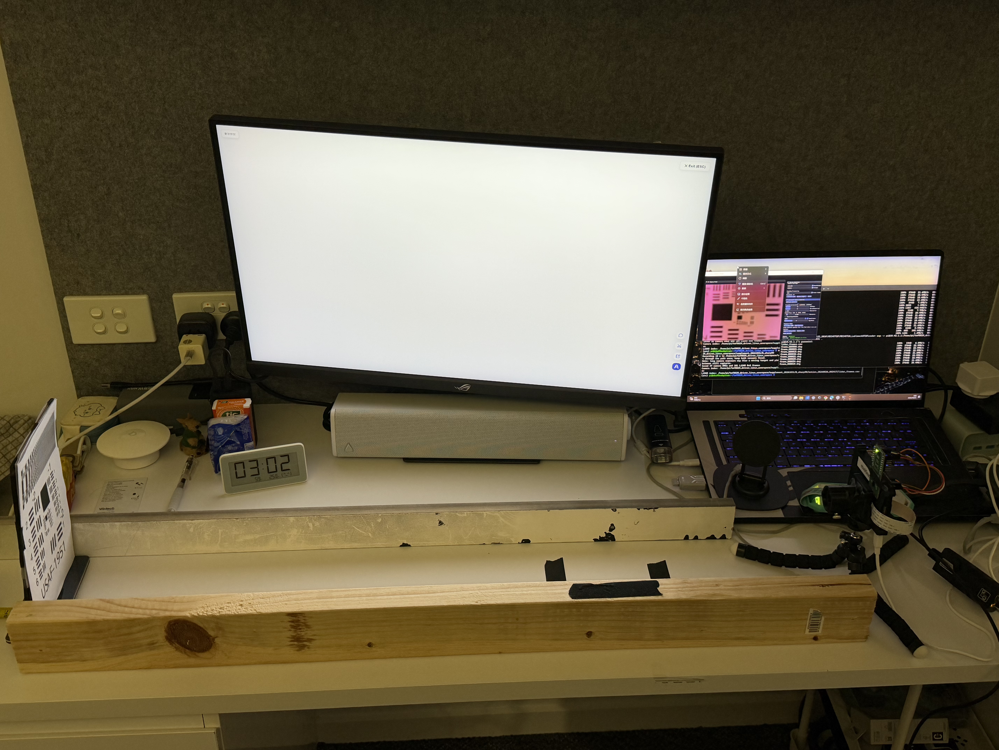
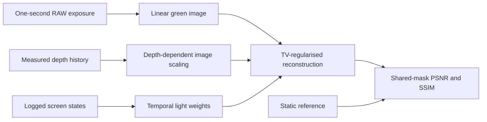
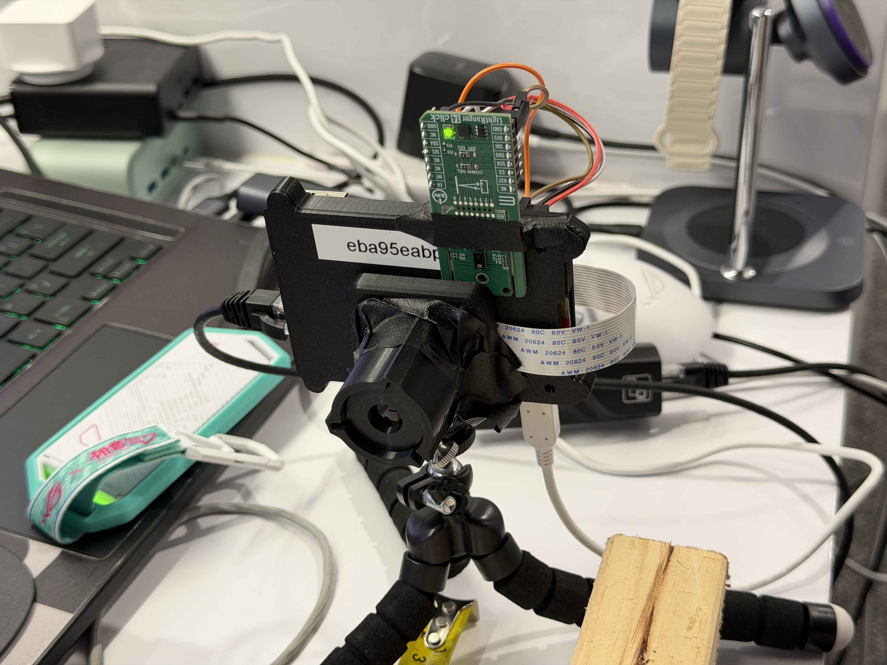
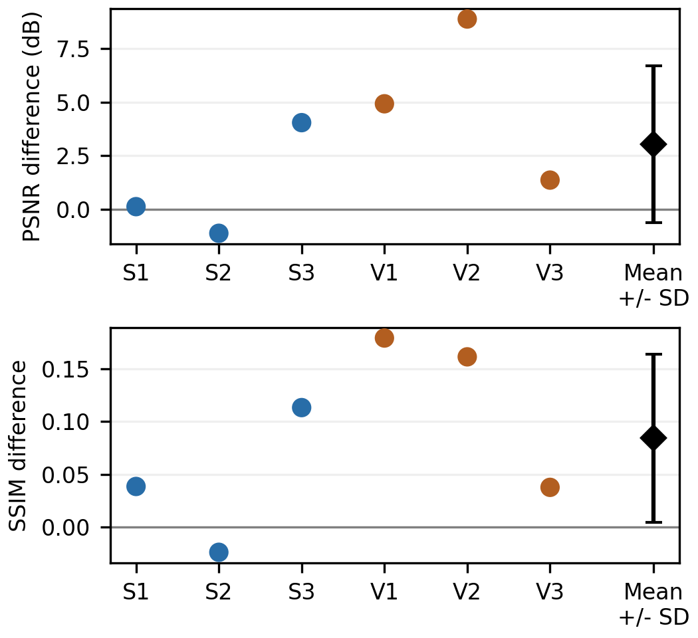
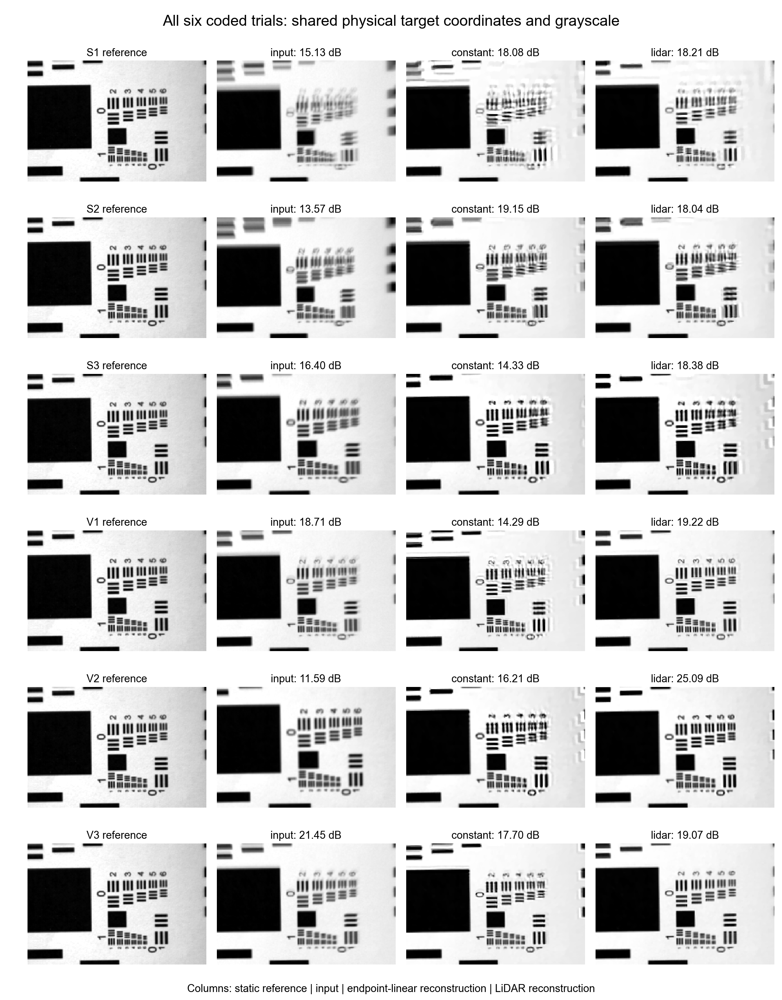

# MECH5720 2026: LiDAR-Guided Reconstruction of Axial Motion Blur

**Qi Wang · Sai S. Vissavajjhala · Jarvis Du · Marco Pham**  
The University of Sydney | Major Project

[Read the report](docs/report.pdf) · [Report source](docs/report_source/main.tex)

We used a depth sensor to study blur as a printed target moves towards a camera. A manual guide keeps the target on its path while the fixed camera records one-second RAW exposures. We then use the measured depth history to reconstruct the changing image scale. A monitor beside the path supplies steady white or temporally coded light.

Measured depth gave higher PSNR and SSIM than the matched endpoint-linear model in **5/6 independent coded-light trials**. The mean paired PSNR gain was **+3.04 dB**, with a sample standard deviation of **3.67 dB**. Below, we show all six results, including the cases where reconstruction did worse.

<p align="center">
  
</p>

*Our supplementary setup: a team-built guide, an existing upright target stand and the kit camera/depth assembly. The monitor illuminates the paper from the side.*

**[Quick start](#quick-start) · [How it works](#how-it-works) · [Build guide](#build-guide) · [Capture](#capture-new-data) · [Results](#results) · [Data](#data-and-file-layout) · [Pitfalls](#known-pitfalls)**

## Quick start

You can reproduce the recorded results without the hardware. Open a local terminal in the repository root, alongside `reproduce.py`.

### 1. Obtain the code and data

Download or clone the repository, then extract the separate **`02_raw_data_release.zip`** into its root. Check that this path exists:

```text
data/supplement_20261031/<condition>/<original-run>/camera_frames.csv
```

The RAW archive is available in [RAW acquisition data v1.0](https://github.com/Jarvis-xuhui-du/mech5720-2026-Lidar-reconstruction-of-axial-motion/releases/tag/raw-data-v1.0). Download [`02_raw_data_release.zip`](https://github.com/Jarvis-xuhui-du/mech5720-2026-Lidar-reconstruction-of-axial-motion/releases/download/raw-data-v1.0/02_raw_data_release.zip) and extract it into the repository root. The source-code ZIP does not include these data.

### 2. Install the analysis environment

We checked the calculations with Python 3.12.7. Use Python 3.12, preferably in a separate environment, and install the dependencies from the repository root:

```sh
python -m pip install -r requirements.txt
```

The file pins NumPy, SciPy, pandas, OpenCV, rawpy, scikit-image and Matplotlib for desktop analysis. To capture new data, the Pi also needs the kit's Picamera2/libcamera environment, Flask and Pillow.

### 3. Regenerate the key figures and verify the metrics

```sh
python reproduce.py
```

This checks the hashes of **1,444 source files** and recalculates PSNR/SSIM from the saved arrays for **16 motion attempts**. It also regenerates the paired-effect and evaluation-mask figures. The default run checks saved results; use the options below to run the solver again from RAW.

| Output | Purpose |
|---|---|
| `reproduced/paired_effects.pdf` and `.png` | Six paired model differences, with mean and sample SD |
| `reproduced/evaluation_mask.pdf` and `.png` | Shared scoring region |
| `reproduced/six_coded_trials_PSNR_SSIM.csv` | Main six-trial comparison |
| `reproduced/all_16_recomputed_metrics.csv` | Metrics recomputed from all saved motion-attempt arrays |
| `reproduced/verification.json` | Environment, numerical errors and data checks |

To reconstruct a single coded trial from RAW with the supplied endpoint geometry:

```sh
python reproduce.py --trial S1
```

To rerun all 16 retained motion attempts from RAW:

```sh
python reproduce.py --reconstruct
```

RAW reconstruction takes longer. The replay check allows differences of 0.01 dB PSNR and 0.0002 SSIM from the saved results. Keep `analysis/cache/` and `analysis/results/`, which hold the geometry and image arrays needed to reproduce the analysis.

## How it works



1. The camera integrates the moving printed pattern while the depth sensor records its approach. We also log the monitor's announced black/white states.
2. We subtract RAW black levels, normalise by white level and average the two green samples in each Bayer cell. We then resize to 240 × 180 linear-grayscale pixels and filter invalid readings from the central 2 × 2 depth zones.
3. Interpolated depth and light records describe the exposure. The endpoint calibration converts depth into image scale; a weighted sum of scaled views predicts the blurred photograph.
4. We solve a non-blind least-squares problem with total variation (TV) regularisation, then score the methods in the same reference coordinates and mask.

The forward operator is

$$
y \approx Ax,\qquad A=\sum_{k=1}^{48}w_k W(z_k),
$$

and reconstruction solves approximately

$$
\min_{0\leq x\leq1}\frac12\lVert Ax-y\rVert_2^2+\lambda\mathrm{TV}(x).
$$

Here, x is the unknown sharp image and y is the recorded blurred photograph. W scales the image according to depth, while w gives the normalised illumination weight. The accelerated solver is inspired by FISTA and uses an approximate TV step. We use λ = 0.002, 320 accelerated proximal-gradient iterations and 35 inner TV iterations. Axial expansion produces a different blur at each image position, so the inverse problem needs a spatially varying operator instead of a single uniform convolution PSF.

For comparison, the endpoint-linear model joins the same start and end depths with a straight line. Both reconstructions use the same coded image, light weights, geometry, solver and scoring mask; the interior depth trajectory is the only difference. The saved-file label “constant” means constant depth velocity in this model. It does not mean a stationary target.

The 48 integration bins come from interpolation of about 10 to 11 received depth frames. They do not increase the number of independent measurements. A static reference assists registration and shared contrast matching, so evaluation is reference assisted.

## Build guide

### Parts and sources

| Component | Source / identification | Role |
|---|---|---|
| Raspberry Pi 3 Model B+ | [Official product](https://www.raspberrypi.com/products/raspberry-pi-3-model-b-plus/) | Camera/depth acquisition and timestamp logging |
| LightRanger 14 Click / TMF8829 | [MIKROE board documentation](https://www.mikroe.com/lightranger-14-click) | 8 × 8 depth measurements; recorded I²C address 0x41 |
| OV5647 camera and camera ribbon | Course kit; [Arducam supplier](https://www.arducam.com/) | RAW acquisition; exact camera SKU unrecorded |
| Lens, camera plate and tripod | Existing course kit | Unchanged Lab 1 lens, nominal focal length approximately 30 mm; exact lens part number and aperture unrecorded |
| ASUS ROG Strix XG27UCGR monitor | [Official specifications](https://rog.asus.com/monitors/27-to-31-5-inches/rog-strix-xg27ucg-gen2-xg27ucgr/spec/) | Side illumination; configured 160 Hz and brightness-menu value 90 |
| Printed USAF 1951 target and upright stand | Existing course materials | Pattern held upright; original print scaling unrecorded |
| Two guide edges, ruler and tape | Available workshop/household materials | Team-built manual guide; exact rail dimensions unrecorded |
| Jumper wires | 2.54 mm female-to-female jumpers | Depth-board power and I²C connections |

### Assemble the apparatus

1. Fix the camera and depth board on the kit plate/tripod. Keep their relative pose unchanged and leave the sensor window clear. Support the wiring so cable movement does not disturb the mount.
2. Secure two straight guide edges and the ruler to the table. Set their spacing from the actual target-base width: the base must slide freely while limiting lateral motion. Check the full travel by hand.
3. Place the existing upright target stand between the guides. Mark 75 cm and 65 cm at the **base-front** datum. In this apparatus the paper plane is 22 mm beyond that datum, corresponding to 772 mm and 672 mm paper references.
4. Put the monitor beside the path so it lights the paper. Keep the monitor and the operator's hands outside the selected central depth zones. Fix monitor position, camera focus/aperture and sensor pose across conditions.
5. With power off, check the actual board revision and pin labels before wiring. The recorded I²C configuration connects board **3V3 → Pi physical pin 1, GND → 6, SDA → 3, SCL → 5, EN → 17**. These are physical pin numbers, not BCM numbers. The 3V3 and EN connections use 3.3 V; do not substitute 5 V. Connect the camera ribbon to the Pi camera connector.

<p align="center">
  
</p>

*The sensor assembly as used, including its taped mount. Mounting stiffness and optical alignment were not measured. We used an existing upright target stand.*

Our contribution beyond the kit/labs is the guide and the integrated physical experiment. The camera, upright stand and depth board were supplied components, and the reconstruction draws on published ideas.

## Capture new data

For new runs, check calibration and timing on the actual apparatus. The commands assume the repository is at **`/home/pi/MECH5720_Major_project`** on the Pi. Replace that path and the example address `10.42.1.1` if your installation differs.

### 1. Prepare the Pi and start the camera server

Enable I²C and check that the depth board responds at 0x41. In a **Pi terminal**:

```sh
cd /home/pi/MECH5720_Major_project/acquisition
make
python3 stream_integrated.py
```

Leave the server running and open a second Pi terminal for recording. With the paper stationary, check focus, clipping, depth coverage and exposure metadata. Collect stationary depth/photometric controls and short-exposure timing controls before the main pushes.

### 2. Set exposure and start recording on the Pi

In the **second Pi terminal**:

```sh
cd /home/pi/MECH5720_Major_project/acquisition
curl -sS -X POST http://127.0.0.1:8000/exposure_mode -H 'Content-Type: application/json' -d '{"mode":"long","exposure_us":1000000,"gain":1}'
```

For **steady-white illumination**, show a full-screen white image on the illumination monitor and run:

```sh
sudo python3 capture_motion.py --seconds 20 --out ../new_runs/white
```

For **coded illumination**, run:

```sh
sudo python3 capture_motion.py --seconds 20 --illumination-udp-port 5051 --out ../new_runs/coded
```

### 3. Play the code on Windows

For the coded condition, open a **local Windows terminal** in this repository's root and run:

```powershell
python .\acquisition\coded_screen_player.py --pi-ip 10.42.1.1 --seconds 12 --bit-ms 200
```

Move the player onto the illumination monitor and press F for fullscreen. Once the Pi recorder is running, press S to play `1101001101` at a nominal 200 ms per bit. The player needs Tkinter and access to UDP port 5051 on the Pi.

Hold the target still, push it once along the marked path towards the sensors, then hold it at the endpoint. Follow the smooth or variable-speed instruction; the recorded depth history captures departures from constant speed. Our formal dataset has three independent pushes for each white/coded × smooth/variable condition.

### 4. Inspect and transfer

Each run should contain DNGs, `camera_frames.csv`, `lidar_frames.csv`, `manifest.json` and `lidar_driver_log.txt`. Coded runs additionally need `illumination_events.csv`. Check actual exposure, valid depth coverage, screen-event coverage, endpoint images and target motion before dismantling the apparatus. The recorded main exposure was **999942 µs**, with gain 1 requested.

Copy the actual run directory to Windows using `scp -r`. Retain original manifests, raw logs and unsuccessful attempts. The Pi calendar was incorrect during this dataset: original folder dates are preserved, while alignment uses monotonic timestamps.

The supplied selections and registration belong to this dataset. For new captures, complete QC, registration and exposure selection before reconstruction; `reproduce.py` does not add new runs automatically. Save that analysis separately from the delivered results.

## Results

The supplementary dataset comprises **40 runs and 1,239 DNGs**. Twelve primary motion pushes cross steady/coded illumination and smooth/variable motion, with three independent repeats in each cell. Two pilots and two weak-motion attempts are also retained, giving 16 motion attempts in the archive.

The main comparison uses **six coded pushes**, with one selected exposure from each. S and V identify smooth and variable-push instructions; repeat numbers run from 1 to 3. All methods are scored on the same 28,327 pixels out of the 43,200-pixel image.

| Trial | Input PSNR (dB) | Endpoint-linear PSNR (dB) | LiDAR PSNR (dB) | Input SSIM | Endpoint-linear SSIM | LiDAR SSIM |
|---|---:|---:|---:|---:|---:|---:|
| S1 | 15.13 | 18.08 | 18.21 | 0.646 | 0.728 | 0.767 |
| S2 | 13.57 | 19.15 | 18.04 | 0.564 | 0.789 | 0.765 |
| S3 | 16.40 | 14.33 | 18.38 | 0.712 | 0.664 | 0.777 |
| V1 | 18.71 | 14.29 | 19.22 | 0.791 | 0.647 | 0.826 |
| V2 | 11.59 | 16.21 | 25.09 | 0.523 | 0.745 | 0.906 |
| V3 | 21.45 | 17.70 | 19.07 | 0.878 | 0.803 | 0.840 |

Subtracting endpoint-linear from LiDAR gives **+3.04 ± 3.67 dB PSNR** and **+0.084 ± 0.080 SSIM** across the six pushes (mean ± sample SD). The SD describes variation between pushes, not a confidence interval or the uncertainty of one sensor reading.



*Positive values favour measured depth over the matched endpoint-linear model. S2 favours endpoint-linear. Each trial contributes one selected exposure.*

<details>
<summary>View all six coded reconstructions</summary>



*The gallery includes every coded trial in canonical reference coordinates. Metrics use the irregular common-support mask within the displayed crops. The reference is a camera image and has finite optical resolution.*

</details>

S2 gives 18.04 dB with LiDAR and 19.15 dB with endpoint-linear. V3 gives 19.07 dB with LiDAR, compared with 21.45 dB for the input and 17.70 dB for endpoint-linear. Thus a reconstruction can beat the simpler motion model and still degrade the original photograph.

The white and coded images come from separate pushes with unmatched trajectories and light dose. We therefore cannot use their scores to isolate a coding advantage.

## Data and file layout

```text
README.md
assets/                         Actual photos and result previews
acquisition/                    Pi capture/server, Windows player, TMF8829 driver
analysis/
  analysis_core.py              RAW processing, geometry, operator, solver, metrics
  prepare_analysis.py           Source audit, reference and geometry preparation
  run_reconstruction.py         Matched reconstructions and diagnostic runs
  summarize_results.py          Trial tables and grouped summaries
  make_figures.py               Full analysis figure generation
  figure_support/               Figure-layout checks used by make_figures.py
  cache/                       Frozen geometry, reference and evaluation arrays
  results/                     Saved reconstruction arrays and timelines
  *.csv, *.json                Results, selections, settings and source hashes
data/supplement_20261031/        Extracted separately from the RAW archive
reproduce.py                    Key-figure verification and optional RAW replay
requirements.txt                Pinned numerical dependencies
LICENSE.txt                     Non-commercial teaching/research permission
LICENSE_NOTICE.txt              Third-party provenance and exclusions
```

`analysis/source_checksums.json` records the original source-file sizes and SHA256 values. The raw archive is approximately 284 MiB compressed. Extract it without renaming the original condition/run folders. The earlier five-trial exploratory dataset is separate and is not pooled into these six coded trials.

For a fresh preparation from RAW, use a separate copy of `analysis/`, install its optional dependencies from `analysis/requirements.txt`, and set `MECH5720_DATA_ROOT` to the absolute `data/supplement_20261031` directory before running `prepare_analysis.py`, `run_reconstruction.py`, `summarize_results.py` and `make_figures.py` in that order. Fresh SIFT/RANSAC registration can vary across OpenCV versions. Use the delivered frozen geometry and `reproduce.py` when checking the reported numbers.

## Known pitfalls

- Event receipt times describe software timing. The fitted 26 ms offset does not measure optical transitions or establish hardware synchronisation; rolling-shutter row timing was also unmeasured.
- Ambient light remains when the screen is black. We model it with a 0.19 relative light floor. Brightness-menu value 90 is a setting, with no measured luminance or defined percentage attached.
- The 22 mm offset converts the target-base datum to the paper plane. Do not subtract it from every LiDAR reading.
- Axial scaling omits full pose and depth-dependent defocus. These omissions, or timing errors, can create artefacts and lower PSNR/SSIM. Our tests do not isolate the physical cause of V3's loss.
- Use the same static-reference registration, contrast matching, mask and display range for all methods. Leave the reference unchanged and retain outcomes that score poorly.
- For a rebuild, measure the rail dimensions, mounting stiffness, aperture and optical-origin/ruler-zero relation. Those values were not recorded and cannot be recovered reliably from the photos.
- Preserve scientific `.npz`/`.npy` arrays, raw logs and source hashes. Exclude virtual environments, bytecode, credentials and duplicate delivery ZIPs from the tracked code.

## Licence

The team's original contributions may be reused for non-commercial teaching and academic research under [LICENSE.txt](LICENSE.txt), with attribution and the licence retained. Other uses require separate permission.

## Method sources

Temporal coding follows the idea of coded exposure photography [1], adapted here to monitor illumination and axial scaling. TV regularisation follows [2], and our accelerated proximal-gradient solver is inspired by FISTA [3]. Endpoint registration uses SIFT features [4]; image quality is evaluated with PSNR and SSIM [5].

1. R. Raskar, A. Agrawal and J. Tumblin, “Coded exposure photography: motion deblurring using fluttered shutter,” ACM Transactions on Graphics, 25(3), 795–804, 2006. [DOI](https://doi.org/10.1145/1141911.1141957)
2. L. I. Rudin, S. Osher and E. Fatemi, “Nonlinear total variation based noise removal algorithms,” Physica D, 60, 259–268, 1992. [DOI](https://doi.org/10.1016/0167-2789(92)90242-F)
3. A. Beck and M. Teboulle, “A fast iterative shrinkage-thresholding algorithm for linear inverse problems,” SIAM Journal on Imaging Sciences, 2(1), 183–202, 2009. [DOI](https://doi.org/10.1137/080716542)
4. D. G. Lowe, “Distinctive image features from scale-invariant keypoints,” International Journal of Computer Vision, 60(2), 91–110, 2004. [DOI](https://doi.org/10.1023/B:VISI.0000029664.99615.94)
5. Z. Wang, A. C. Bovik, H. R. Sheikh and E. P. Simoncelli, “Image quality assessment: From error visibility to structural similarity,” IEEE Transactions on Image Processing, 13(4), 600–612, 2004. [DOI](https://doi.org/10.1109/TIP.2003.819861)
