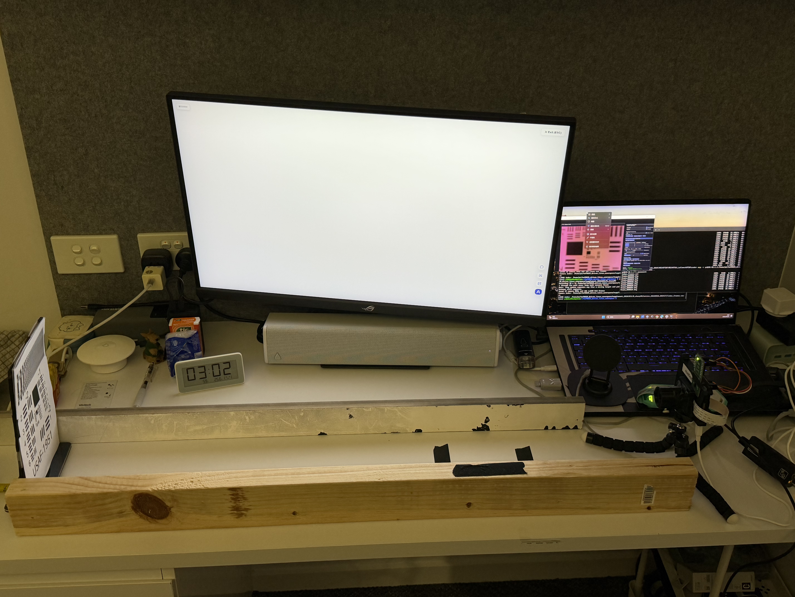
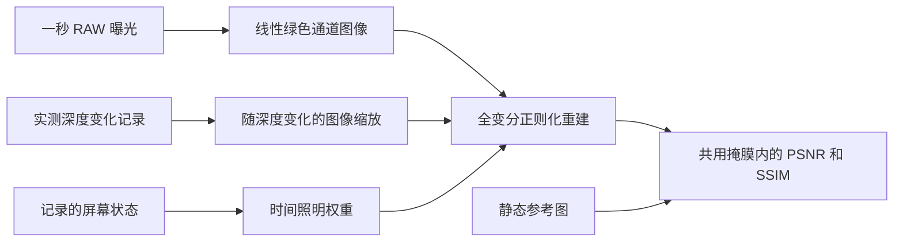
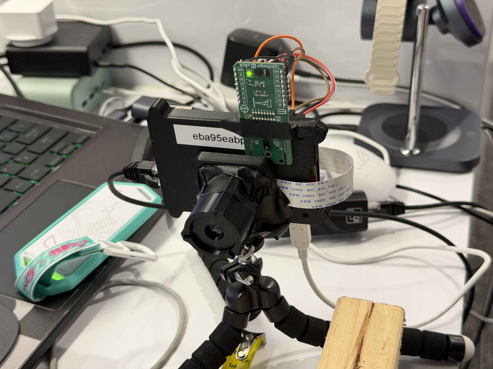
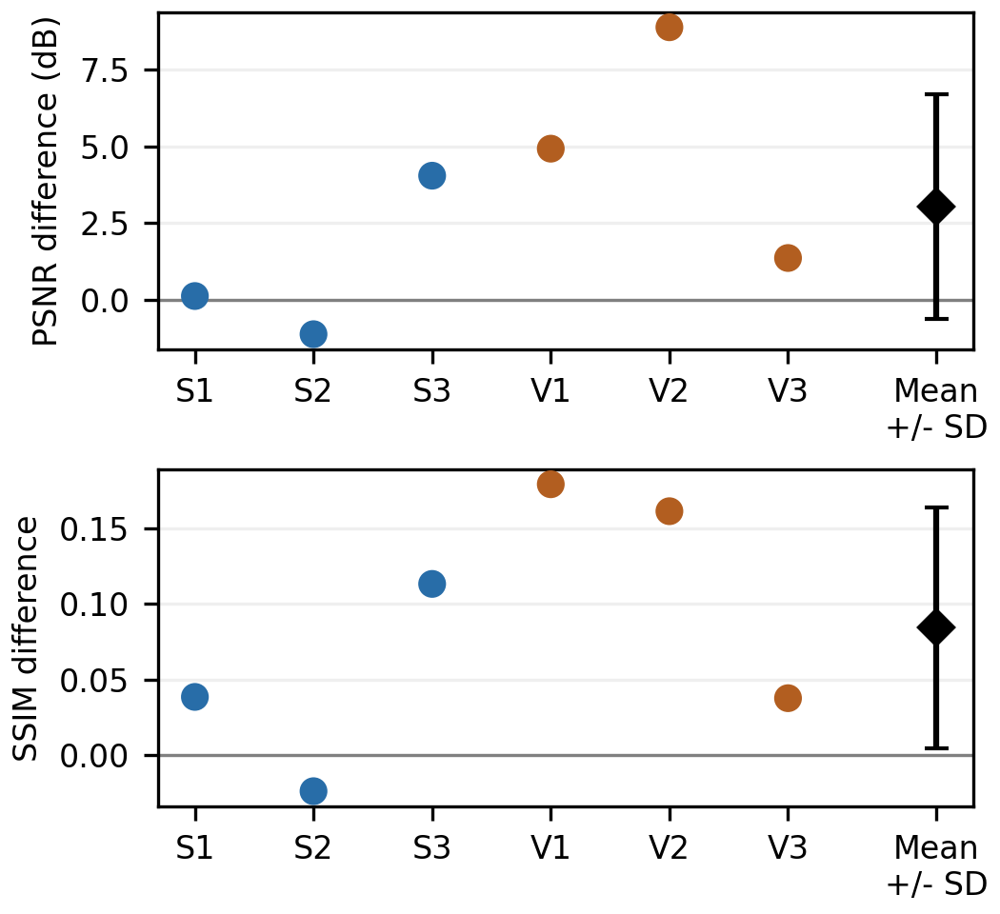
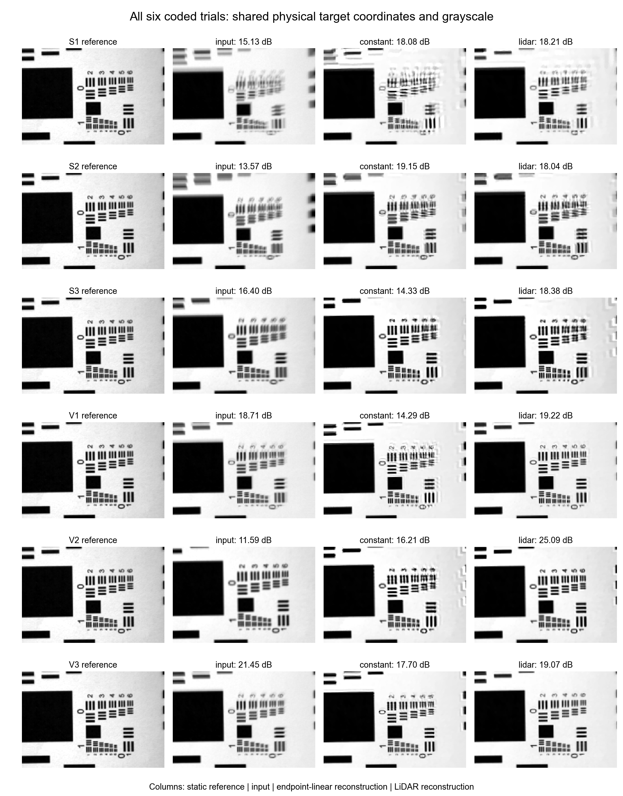

# MECH5720 2026：LiDAR 引导的轴向运动模糊重建

**Qi Wang · Sai S. Vissavajjhala · Jarvis Du · Marco Pham**  
悉尼大学 | 课程大作业

我们用深度传感器研究目标接近相机时产生的运动模糊。目标沿手动导轨移动，固定相机记录一秒 RAW 曝光，再利用这段时间内测得的深度变化重建图像。路径侧面的显示器提供恒定白光或随时间变化的编码照明。

六次独立编码光试验中，实测深度模型有 **5/6 次**的 PSNR 和 SSIM 都高于条件一致的端点线性模型。配对 PSNR 平均提高 **3.04 dB**，样本标准差为 **3.67 dB**。下文展示全部六次结果，也包括重建效果下降的情况。

<p align="center">
  
</p>

*补充实验装置：团队搭建的导轨、现成的直立目标支架，以及套件提供的相机和深度传感器组件。显示器从侧面照亮纸面。*

**[快速开始](#quick-start) · [工作原理](#how-it-works) · [搭建指南](#build-guide) · [数据采集](#capture-new-data) · [实验结果](#results) · [数据](#data-and-file-layout) · [已知问题](#known-pitfalls)**

<a id="quick-start"></a>

## 快速开始

不用连接硬件，也可以复现已采集数据的结果。先打开本地终端，进入仓库根目录，也就是 `reproduce.py` 所在的位置。

### 1. 获取代码和数据

下载或克隆仓库，再将单独提供的 **`02_raw_data_release.zip`** 解压到仓库根目录。检查下面的路径是否存在：

```text
data/supplement_20261031/<condition>/<original-run>/camera_frames.csv
```

RAW 数据包已经准备好，但本 README 尚未核实它是否已作为 Release 附件发布。可先在[仓库 Releases 页面](https://github.com/Jarvis-xuhui-du/MECH5720_Major_project/releases)查找 `02_raw_data_release.zip`；若没有，请向团队获取。源码 ZIP 不包含这些原始数据。提交前，团队还需发布数据包，并在这里补上带版本的直接下载链接。

### 2. 安装分析环境

我们用 Python 3.12.7 核对了计算结果。请使用 Python 3.12，最好单独建一个环境，然后在仓库根目录安装依赖：

```sh
python -m pip install -r requirements.txt
```

依赖文件为电脑端分析固定了 NumPy、SciPy、pandas、OpenCV、rawpy、scikit-image 和 Matplotlib 的版本。若要采集新数据，树莓派还需要套件使用的 Picamera2/libcamera 环境，以及 Flask 和 Pillow。

### 3. 重新生成关键图并核对指标

```sh
python reproduce.py
```

命令会检查 **1,444 个源文件的哈希值**，用保存的数组重新计算 **16 次运动采集尝试**的 PSNR/SSIM，同时生成配对差值图和评估掩膜图。默认运行核对的是已保存结果；若要从 RAW 数据重新运行求解器，请使用下面的选项。

| 输出文件 | 用途 |
|---|---|
| `reproduced/paired_effects.pdf` 和 `.png` | 六次配对模型差值，以及均值和样本标准差 |
| `reproduced/evaluation_mask.pdf` 和 `.png` | 所有方法共用的评分区域 |
| `reproduced/six_coded_trials_PSNR_SSIM.csv` | 六次主要编码光试验的比较结果 |
| `reproduced/all_16_recomputed_metrics.csv` | 根据全部已保存运动采集数组重新计算的指标 |
| `reproduced/verification.json` | 软件环境、数值误差和数据核对结果 |

若要使用交付版本的端点几何参数，从 RAW 数据重新重建一次编码光试验：

```sh
python reproduce.py --trial S1
```

若要从 RAW 数据重新运行全部 16 次保留的运动采集尝试：

```sh
python reproduce.py --reconstruct
```

从 RAW 数据重新重建需要更长时间。与保存结果相比，核对允许的偏差为 PSNR 0.01 dB、SSIM 0.0002。请保留 `analysis/cache/` 和 `analysis/results/`，其中的几何参数和图像数组是复现所需的数据。

<a id="how-it-works"></a>

## 工作原理



1. 相机对运动中的打印图案曝光积分，深度传感器记录目标的接近过程，同时保存显示器发出的黑白状态通知。
2. 减去 RAW 黑电平，按白电平归一化，并对每个 Bayer 单元中的两个绿色采样点取平均。随后缩放至 240 × 180 像素的线性灰度图，过滤中央 2 × 2 测距分区的无效深度读数。
3. 对曝光期间的深度和照明记录插值，再用端点标定关系将深度换算为图像尺度。各个缩放视图按照明权重叠加，得到预测的模糊照片。
4. 求解带全变分正则化的非盲最小二乘问题，并在相同参考坐标系和掩膜内评分。

前向算子为：

$$
y \approx Ax,\qquad A=\sum_{k=1}^{48}w_k W(z_k),
$$

重建近似求解以下问题：

$$
\min_{0\leq x\leq1}\frac12\lVert Ax-y\rVert_2^2+\lambda\operatorname{TV}(x).
$$

其中，`x` 是未知清晰图像，`y` 是实测模糊照片；`W` 按深度缩放图像，`w` 给出归一化照明权重。我们使用 λ = 0.002、320 次加速近端梯度迭代，以及每次 35 次内部 TV 迭代。目标沿轴向接近时，图像不同位置的模糊不同，因此需要空间变化的算子，不能使用单一的空间不变卷积点扩散函数（PSF）。

用于比较的端点线性模型用直线连接相同的起始和终止深度。两种重建使用同一幅编码光图像、同一组照明权重、几何参数、求解器和掩膜，只改变曝光内部的深度轨迹。文件中的 `constant` 表示这一模型假设深度速度恒定，并不表示目标静止。

48 个积分区间由约 10 到 11 帧接收到的深度数据插值得到，不会增加独立测量的次数。我们还用静态参考图辅助配准和共用的对比度匹配，因此这里的评估依赖参考图。

<a id="build-guide"></a>

## 搭建指南

### 部件与来源

| 部件 | 来源／型号说明 | 用途 |
|---|---|---|
| Raspberry Pi 3 Model B+ | [官方产品页](https://www.raspberrypi.com/products/raspberry-pi-3-model-b-plus/) | 相机和深度采集、时间戳记录 |
| LightRanger 14 Click / TMF8829 | [MIKROE 开发板文档](https://www.mikroe.com/lightranger-14-click) | 8 × 8 分区深度测量；记录的 I²C 地址为 0x41 |
| OV5647 相机及相机排线 | 课程套件；[Arducam 供应商](https://www.arducam.com/) | RAW 采集；未记录相机的确切产品编号 |
| 镜头、相机安装板和三脚架 | 现有课程套件 | 一直沿用 Lab 1 镜头，标称焦距约 30 mm；未记录确切镜头编号和光圈 |
| ASUS ROG Strix XG27UCGR 显示器 | [官方规格](https://rog.asus.com/monitors/27-to-31-5-inches/rog-strix-xg27ucg-gen2-xg27ucgr/spec/) | 侧面照明；设置刷新率 160 Hz，亮度菜单值 90 |
| 打印的 USAF 1951 目标及直立支架 | 现有课程材料 | 将图案保持直立；未记录原始打印缩放比例 |
| 两条导向边、尺子和胶带 | 可获得的工作坊／日常材料 | 团队搭建的手动导轨；未记录导轨确切尺寸 |
| 跳线 | 2.54 mm 母对母跳线 | 深度传感器板供电及 I²C 连接 |

### 装配步骤

1. 将相机与深度传感器板固定在套件安装板／三脚架上，保持两者相对位姿不变，并确保传感器窗口无遮挡。固定和支撑线缆，避免线缆移动牵动安装组件。
2. 将两条直导向边和尺子固定在桌面。根据实际目标底座的宽度设置间距，使底座能够自由滑动，同时限制横向偏移。手动检查整个行程。
3. 将现成的直立目标支架放在导轨之间。以**底座前缘**为基准标记 75 cm 和 65 cm。在本装置中，纸面比这一基准远 22 mm，因此对应的纸面参考距离为 772 mm 和 672 mm。
4. 将显示器放在运动路径侧面，为纸面照明。显示器和操作者的手应位于选定的中央测距区域之外。各实验条件下保持显示器位置、相机对焦／光圈及传感器位姿不变。
5. 接线前断电，并核对实际开发板版本及引脚标记。已记录的 I²C 接法为：开发板 **3V3 → 树莓派物理引脚 1、GND → 6、SDA → 3、SCL → 5、EN → 17**。这里使用的是物理引脚编号，不是 BCM 编号。3V3 和 EN 使用 3.3 V，不可改接 5 V。将相机排线连接至树莓派相机接口。

<p align="center">
  
</p>

*实际使用的传感器组件及胶带固定方式。安装刚度和光学对准未作测量。直立目标支架使用的是现成部件。*

我们在套件和实验课基础上增加了导轨及整合后的物理实验。相机、直立支架和深度传感器板都是已有部件，重建方法借鉴了已发表的研究。

<a id="capture-new-data"></a>

## 采集新数据

重新采集时，先在实际装置上检查标定和时序。下面假设仓库位于树莓派的 **`/home/pi/MECH5720_Major_project`**。若你的安装不同，请替换路径及示例地址 `10.42.1.1`。

### 1. 准备树莓派并启动相机服务器

启用 I²C，并检查深度传感器板是否在地址 0x41 响应。在**树莓派终端**中执行：

```sh
cd /home/pi/MECH5720_Major_project/acquisition
make
python3 stream_integrated.py
```

保持服务器运行，使用另一个树莓派终端进行录制。在纸面静止时检查对焦、像素饱和、有效目标深度和曝光元数据。在主要推动试验前，采集静态深度／光度对照，以及短曝光时间对照数据。

### 2. 在树莓派上设置曝光并开始录制

在**第二个树莓派终端**中执行：

```sh
cd /home/pi/MECH5720_Major_project/acquisition
curl -sS -X POST http://127.0.0.1:8000/exposure_mode -H 'Content-Type: application/json' -d '{"mode":"long","exposure_us":1000000,"gain":1}'
```

对于**恒定白光照明**，在照明显示器上显示全屏白色图像，然后执行：

```sh
sudo python3 capture_motion.py --seconds 20 --out ../new_runs/white
```

对于**编码照明**，执行：

```sh
sudo python3 capture_motion.py --seconds 20 --illumination-udp-port 5051 --out ../new_runs/coded
```

### 3. 在 Windows 上播放照明编码

对于编码照明条件，在**本地 Windows 终端**中进入仓库根目录，并执行：

```powershell
python .\acquisition\coded_screen_player.py --pi-ip 10.42.1.1 --seconds 12 --bit-ms 200
```

把播放器移到照明显示器上，按 F 全屏显示。树莓派开始录制后，按 S 播放 `1101001101`，每位标称持续 200 ms。播放器需要 Tkinter，并能通过网络访问树莓派的 UDP 5051 端口。

先保持目标静止，沿标记路径向传感器推动一次，再停在终点。按要求平稳推动或刻意变速，偏离恒速的部分会记录在深度轨迹中。正式数据在白光／编码光 × 平稳／变速四种条件下，各采集了三次独立推动。

### 4. 检查并传输数据

每次采集应包含 DNG 图像、`camera_frames.csv`、`lidar_frames.csv`、`manifest.json` 和 `lidar_driver_log.txt`。编码光采集还需要 `illumination_events.csv`。拆除装置前，检查实际曝光、有效深度覆盖、屏幕事件覆盖、端点图像和目标运动。记录的主要曝光时间为 **999942 µs**，请求增益为 1。

使用 `scp -r` 将实际采集文件夹复制到 Windows。保留原始清单、原始日志和未成功的采集尝试。采集该数据集时，树莓派系统日期不正确，因此保留原始文件夹日期命名，时间对齐则使用单调时间戳。

随包提供的选择记录和配准只适用于这份数据。新采集数据需先完成质量检查、配准和曝光选择，`reproduce.py` 不会自动将它们纳入。请将新分析与交付结果分开保存。

<a id="results"></a>

## 实验结果

补充数据集包含 **40 段采集和 1,239 张 DNG 图像**。12 次主要运动推动覆盖恒定／编码照明和平稳／变速运动的四种组合，每种组合有三次独立重复。此外还保留了两次预试验和两次弱运动采集，档案中共包含 16 次运动采集尝试。

主要比较使用**六次编码光推动**，每次选择一次曝光。`S` 和 `V` 分别表示平稳、变速推动指令，独立重复编号为 1 到 3。所有方法都在图像 43,200 个像素中的同一组 28,327 个像素上评分。

| 试验 | 输入 PSNR（dB） | 端点线性 PSNR（dB） | LiDAR PSNR（dB） | 输入 SSIM | 端点线性 SSIM | LiDAR SSIM |
|---|---:|---:|---:|---:|---:|---:|
| S1 | 15.13 | 18.08 | 18.21 | 0.646 | 0.728 | 0.767 |
| S2 | 13.57 | 19.15 | 18.04 | 0.564 | 0.789 | 0.765 |
| S3 | 16.40 | 14.33 | 18.38 | 0.712 | 0.664 | 0.777 |
| V1 | 18.71 | 14.29 | 19.22 | 0.791 | 0.647 | 0.826 |
| V2 | 11.59 | 16.21 | 25.09 | 0.523 | 0.745 | 0.906 |
| V3 | 21.45 | 17.70 | 19.07 | 0.878 | 0.803 | 0.840 |

将 LiDAR 减去端点线性模型，六次推动的配对差值为 **PSNR +3.04 ± 3.67 dB**、**SSIM +0.084 ± 0.080**（均值 ± 样本标准差）。标准差描述推动之间的差异，不代表置信区间或单次传感器读数的不确定度。



*正值表示实测深度优于条件一致的端点线性模型。S2 的端点线性模型更好。每次试验贡献一个选定曝光。*

<details>
<summary>查看全部六次编码光重建结果</summary>



*全部编码光试验都在统一参考坐标系中展示。指标使用显示区域内不规则的共用有效掩膜。参考图由相机拍摄，也受到光学分辨率限制。*

</details>

S2 的 LiDAR 得分为 18.04 dB，端点线性模型为 19.15 dB。V3 的 LiDAR 得分为 19.07 dB，输入为 21.45 dB，端点线性模型为 17.70 dB。也就是说，重建即使胜过较简单的运动模型，仍可能让原始照片变差。

白光和编码光来自不同的实际推动，轨迹与照明剂量也不相同。因此，这些得分不能单独用来判断编码照明是否更好。

<a id="data-and-file-layout"></a>

## 数据与文件结构

```text
README.md
assets/                         实际装置照片和结果预览图
acquisition/                    树莓派采集／服务器、Windows 播放器、TMF8829 驱动
analysis/
  analysis_core.py              RAW 处理、几何关系、前向算子、求解器和指标
  prepare_analysis.py           源数据审查、参考图及几何准备
  run_reconstruction.py         条件一致的重建比较及诊断运行
  summarize_results.py          各次试验表格和分组汇总
  make_figures.py               完整分析图生成
  figure_support/               make_figures.py 使用的图形排版检查
  cache/                       冻结的几何参数、参考图和评估数组
  results/                     保存的重建数组及时间序列
  *.csv, *.json                结果、选择记录、设置和源文件哈希值
data/supplement_20261031/        从 RAW 数据包单独解压得到
reproduce.py                    关键图核对，以及可选的 RAW 重新重建
requirements.txt                固定版本的数值计算依赖
LICENSE_NOTICE.txt              来源和许可状态说明
```

`analysis/source_checksums.json` 记录原始源文件的大小和 SHA256 值。原始数据包压缩后约为 284 MiB。解压时不要修改原始条件／采集文件夹的名称。早期的五次探索性试验数据集单独保留，没有并入这六次编码光试验。

若要从 RAW 数据重新进行准备，请使用一份单独的 `analysis/` 副本，安装 `analysis/requirements.txt` 中的可选依赖，将 `MECH5720_DATA_ROOT` 设置为 `data/supplement_20261031` 的绝对路径，再依次运行 `prepare_analysis.py`、`run_reconstruction.py`、`summarize_results.py` 和 `make_figures.py`。重新进行 SIFT/RANSAC 配准时，结果可能因 OpenCV 版本而变化。核对报告数值时，请使用交付版本的冻结几何参数和 `reproduce.py`。

<a id="known-pitfalls"></a>

## 已知问题与注意事项

- 事件接收时间记录的是软件时序。拟合的 26 ms 偏移不能测出光学切换时间，也不能证明硬件同步；滚动快门的逐行时序同样未作测量。
- 屏幕显示黑色时仍有环境光，我们用 0.19 的相对照明下限描述它。亮度菜单值 90 只是设备设置，没有对应的实测亮度或已定义百分比。
- 22 mm 用于把目标底座基准换算到纸面，不能从每条 LiDAR 读数中直接扣除。
- 轴向缩放没有包含完整位姿和随深度变化的离焦。这些遗漏或时间误差都可能产生伪影并降低 PSNR/SSIM，现有试验尚不能单独确定 V3 下降的物理原因。
- 所有方法使用同一套静态参考图配准、对比度匹配、评分掩膜和显示范围。保留参考图原样，也保留得分较差的结果。
- 复建时需要测量导轨尺寸、安装刚度、光圈及光学原点与尺子零点的关系。这些量未被记录，不能只靠照片可靠还原。
- 保留科研用的 `.npz`／`.npy` 数组、原始日志和源文件哈希值。虚拟环境、字节码、凭据和重复交付 ZIP 不应加入受版本控制的代码。

